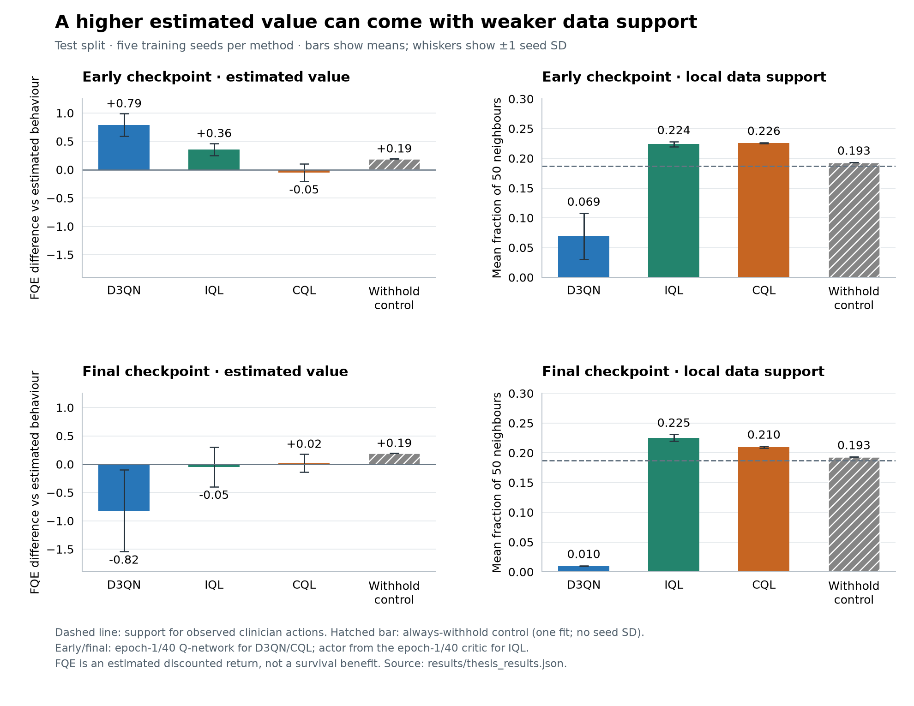
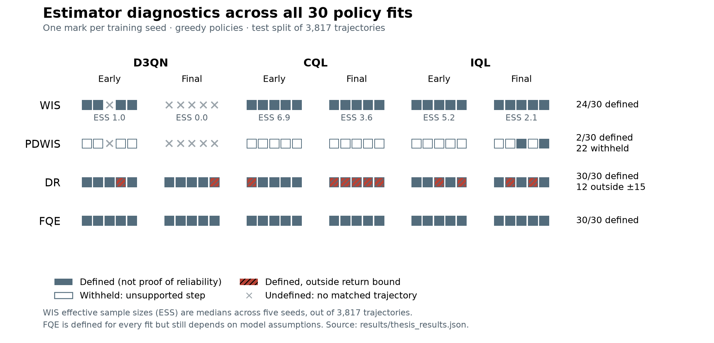

# Evaluating offline reinforcement learning for sepsis treatment

Sepsis treatment requires adjusting fluids and blood-pressure medication as a patient's condition changes. For my MSc thesis at Vrije Universiteit Amsterdam, I studied whether reinforcement learning could learn useful dosing strategies from historical ICU data and how reliably those strategies could be evaluated.

The pipeline uses **25,442 ICU stays from MIMIC-IV v3.1**. It covers data preparation, training with D3QN, Conservative Q-Learning (CQL) and Implicit Q-Learning (IQL), and evaluation against reference policies.

The main result was that estimated value and data support could disagree: the highest-scoring early policy often recommended actions rarely seen in similar patients. A control that always withheld treatment also scored favourably, showing the limits of interpreting these estimates as better care.

[Read the thesis](docs/thesis.pdf) · [Detailed results](docs/results.md) · [Research reproduction](docs/reproduction.md)

## Approach

1. Identify adults meeting Sepsis-3 criteria and keep each patient's first eligible episode.
2. Build four-hour decision steps using information available before each decision. Split by patient and fit preprocessing only on training data.
3. Train three treatment-policy methods across five seeds, retaining both early and final checkpoints.
4. Compare four offline evaluation methods, then check whether the recommended actions resemble actions actually taken for similar patients.

The engineering work includes event timing, infusion allocation, train-only scaling, completion checks for multi-seed experiments, and regression tests for leakage and boundary cases.

## What the experiments found

Results from the MIMIC-IV experiments. Fitted-Q evaluation (FQE) estimates discounted return; its scores do not measure survival improvements.

| Method | Early FQE, mean ± SD | Early unsupported actions | Final FQE, mean ± SD | Final unsupported actions |
|---|---:|---:|---:|---:|
| D3QN | 13.308 ± 0.201 | 57.15% | 11.698 ± 0.720 | 86.19% |
| CQL | 12.468 ± 0.157 | 0.003% | 12.537 ± 0.161 | 1.32% |
| IQL | 12.874 ± 0.109 | 0.066% | 12.470 ± 0.348 | 0.171% |

Test split; five training seeds per method. Unsupported means the recommended action has probability below 0.01 under the estimated behaviour policy, across 37,874 decisions. SD describes training-seed variation. The estimated behaviour reference scores **12.518**, behaviour cloning **12.288**, and always-withhold **12.713**; each reference has one fit.

For D3QN/CQL, early means epoch 1 after 5,000 updates and final means epoch 40. For IQL, these identify the critic used to train the actor; the actor is selected by validation loss in both cases.



- Early D3QN has the highest FQE score, but half its recommendations have no matching action among 50 nearby training decisions.
- Early IQL exceeds the estimated behaviour reference by 0.356 return units. The comparison with the always-withhold control gives Holm p = 0.125 after correcting for multiple comparisons.
- WIS returns an estimate for 24/30 policy fits but has very low effective sample sizes. PDWIS reports only 2/30; DR exceeds the possible return range in 12/30. FQE returns estimates for all 30, but remains sensitive to extrapolation and model fitting.



WIS = weighted importance sampling; PDWIS = per-decision weighted importance sampling; DR = doubly robust estimation. A defined estimate does not establish reliability. See [the full table](docs/results.md) and [source details](docs/results-provenance.md).

## Reproduce the figures

The saved aggregate results are included. Both charts and the results table can be regenerated without patient data or dataset credentials.

Tested with Python 3.13. From this directory:

```bash
python -m venv .venv
source .venv/bin/activate
python -m pip install -r requirements-figures.txt
python -m scripts.plot_results
```

This reads `results/thesis_results.json` and writes PNG/SVG figures under `figures/` and the table to `docs/results.md`. To recompute the findings from clinical records, follow the [research workflow](docs/reproduction.md) with authorised MIMIC-IV access.

## Run the code and tests

```bash
python -m pip install -r requirements.txt
python -m pytest -q
python -m examples.synthetic_demo
```

The demo uses 80 synthetic subjects to exercise preprocessing, a short training run and evaluation. Its outputs test the software and have no clinical interpretation.

## Code map

| Location | Purpose |
|---|---|
| `src/final_cohort.py`, `src/final_features.py` | Cohort selection and past-only clinical features |
| `src/final_preprocessing.py` | Patient splits, scaling, action bins and transitions |
| `src/train.py`, `src/train_iql.py`, `src/train_iql_actor.py` | D3QN/CQL and IQL training |
| `src/final_campaign.py` | Staged, multi-seed research runs |
| `src/final_fqe.py`, `src/final_ope.py`, `src/data_support.py` | Policy evaluation and support diagnostics |
| `scripts/export_results.py`, `scripts/plot_results.py` | Aggregate export and reproducible figures |
| `tests/` | Regression tests on constructed inputs and result-integrity checks |

## Data and limitations

MIMIC-IV access must be obtained separately. This repository contains code and aggregate results; it does not distribute patient records, per-patient evaluation arrays or trained checkpoints.

The study is retrospective and uses one hospital dataset. It does not establish a causal treatment benefit, and no policy was deployed in patient care.

Author: Felix Nastar. [Release notes](docs/release-notes.md) · [Validation](docs/validation.md)
